# Awesome B2B Partner Collaboration Workspaces & Client Portals

**A curated index of B2B partner collaboration workspaces, enterprise client portals, external guest bridges, and self-hosted open-source collaboration platforms.**

---

## Table of Contents

- [Sector Overview & Market Dynamics](#sector-overview--market-dynamics)
- [Proprietary SaaS Solutions](#proprietary-saas-solutions)
  - [Overview Table (Sorted by Company Scale)](#overview-table-sorted-by-company-scale)
  - [Architectural Categories](#architectural-categories)
- [Open-Source Solutions](#open-source-solutions)
- [Key Architectural Considerations](#key-architectural-considerations)
- [Contributing](#contributing)
- [License](#license)

---

## Sector Overview & Market Dynamics

The global client portal software and dedicated B2B collaboration market is estimated at **$1.75B to $2.2B**, expanding toward **$8.0B by the early 2030s** at an estimated CAGR of ~18%, operating within the broader **$430B+ global B2B SaaS** and enterprise collaboration ecosystem.

The sector exhibits **moderate fragmentation with bi-modal concentration**: mega-cap ecosystem titans (Microsoft, Salesforce/Slack) dominate horizontal inter-organization messaging and shared channels ("winner-take-most" in general business communication), while specialized B2B workflows—such as white-label agency client portals, secure virtual data rooms (VDRs), sales enablement rooms, and open-source self-hosted portals—remain highly fragmented among niche providers competing on custom branding, regulatory compliance, client permissions, and multi-tenant isolation.

---

## Proprietary SaaS Solutions

### Overview Table (Sorted by Company Scale)

The table below catalogs proprietary B2B partner workspace and client portal platforms, sorted in descending order by **Company Scale (Valuation or Market Capitalization / Annual Revenue)**.

| SaaS Product | Category / Type | Company Scale (Valuation / Revenue) | Starting Price (Specific Tier) | Free Tier / Free Trial Limits | Primary B2B Collaboration Capabilities |
| :--- | :--- | :--- | :--- | :--- | :--- |
| **[Microsoft Teams Shared Channels](https://www.microsoft.com/en-us/microsoft-teams/group-chat-software)** | Built-in Shared Channels (B2B Direct Connect) | **$3.1T Market Cap** (~$245B+ ARR) | **$0 extra** (Included in Microsoft 365 Business Basic at **$6.00/user/mo** annually) | **Entra ID Free tier supported**: External cross-tenant users join without extra guest licensing; Free Teams tier has 60-min group meeting limit and 5 GB cloud storage. | Uses Microsoft Entra B2B Direct Connect to allow external partner teams to collaborate across org boundaries without switching tenants or managing separate logins. |
| **[Slack Connect](https://slack.com/connect)** | Built-in Shared Channels | **$27.7B Acquisition** (~$1B+ ARR) | **$7.25/user/mo** (Slack Pro, billed annually) | **Free Forever plan**: Restricted to 1-to-1 external partner channels only; 90-day message history limit; multi-organization group channels require paid plan. | Secure cross-company channels linking up to 250 verified partner organizations with enterprise security retention rules and partner directory discovery. |
| **[Notion Teamspaces](https://www.notion.so/product/teamspaces)** | Knowledge Base & Teamspaces | **$11.0B Valuation** (~$865M ARR) | **$10.00/user/mo** (Plus plan, billed annually) | **Free Forever plan**: Unlimited blocks for 1 user, strictly 1,000 blocks for 2+ members; max 10 external guests; 5 MB file upload cap; 7-day version history. | Structured teamspaces with customizable permission levels (Open, Closed, or Private for Business/Enterprise); granular external page-level guest invitations. |
| **[Postman Partner Workspaces](https://www.postman.com/partner-workspaces/)** | API & Developer Collaboration Portal | **$5.6B Valuation** (~$313M ARR) | **$29.00/user/mo** (Professional plan, billed annually) | **Free Forever plan**: Limited to 3 team members, public/personal workspaces only (no Partner Workspaces); 14-day free trial of Professional plan available. | Dedicated multi-organization workspaces for sharing API collections, mock servers, and environments securely with external vendor and partner engineering teams. |
| **[Highspot Digital Rooms](https://www.highspot.com/)** | Sales Enablement & Client Engagement | **$3.5B Valuation** (~$150M+ ARR) | **$45.00/user/mo** (Plus base platform fee starting at ~$25,000/yr minimum commitment) | **No Free Tier**: No public self-serve free trial; access is provided strictly through vendor-guided enterprise sandbox demos. | External Digital Sales Rooms and partner buyer microsites offering unified collateral management, interaction engagement tracking, and pitch analytics. |
| **[Box Hubs](https://www.box.com/)** | Content Portal & Secure Document Hubs | **$3.4B Market Cap** (~$1.2B ARR) | **$5.00/user/mo** (Business Starter, 3-seat minimum; Box Hubs unlocked on Enterprise plans) | **Free Individual plan**: 10 GB total storage, 250 MB max single-file upload limit; 14-day free trial on Business plans (up to 10 users). | Centralized, secure content portals aggregating enterprise files, folders, and documents with role-based external sharing, Box AI metadata search, and watermarking. |
| **[Asana External Guests](https://asana.com/)** | Work Management & External Guest Access | **$2.0B Market Cap** (~$790M ARR) | **$10.99/user/mo** (Starter plan, billed annually) | **Free Personal plan**: Strictly capped at 2 members; unlimited tasks/projects, 100 MB per file limit; external contractors require paid full-seat licenses. | Project-level external collaboration; guest seats are priced identically to internal users ($10.99–$30.49/mo) with full audit visibility. |
| **[ClientPoint](https://www.clientpoint.net/)** | Enterprise Client Portal & Proposal Rooms | **$45M Valuation** (~$6.3M ARR) | **$42.00/user/mo** (Standard tier, billed annually) | **14-day Free Trial**: Full portal features, limited to 3 active client rooms and 20 GB user storage during evaluation; no credit card required. | White-label client engagement workspaces, interactive proposal builders, document analytics, live video meeting integration, and enterprise CRM sync. |
| **[Clinked](https://www.clinked.com/)** | White-Label Client Portal & Virtual Data Room | **$1.7M Valuation** (~$2.5M ARR) | **$95.00/mo** (Starter plan with 100 members, 100 GB storage, billed annually) | **10-day Free Trial**: Unlimited access to Starter workspace features with full collaboration tools, capped at 100 MB uploads during trial period. | Fully branded client portals, multi-tenant external workspaces, virtual data rooms (VDRs) with digital rights management, watermarking, and audit logs. |

---

### Architectural Categories

1. **Integrated Cross-Organization Communication Channels**:
   - Features embedded directly within major team productivity tools (e.g., Slack Connect, Teams Shared Channels, Postman Partner Workspaces).
   - Designed to avoid switching contexts while maintaining corporate compliance controls.
2. **Dedicated Client Portals & Virtual Data Rooms (VDR)**:
   - Standalone systems purpose-built for client onboarding, secure file sharing, NDAs, and deal rooms (e.g., Clinked, ClientPoint, Box Hubs).
   - Characterized by white-label branding, client login portals, and forensic audit logging.
3. **Sales Enablement & Deal Rooms**:
   - Focused on buyer-seller collaboration, mutual action plans (MAPs), and proposal evaluation (e.g., Highspot).

---

## Open-Source Solutions

The table below catalogs open-source repositories designed for client portals, partner collaboration, internal-to-external workspaces, and embeddable document collaboration. Sorted in descending order by **GitHub Star Count**.

| Repository & Stargazers | Category / Tech Stack | Description & Collaboration Focus |
| :--- | :--- | :--- |
| **[twentyhq/twenty](https://github.com/twentyhq/twenty)**  | Modern Open-Source CRM & Partner Portal `TypeScript` `React` `NestJS` `PostgreSQL` | Highly extensible, modern CRM platform that provides custom partner relationship management, customer object mapping, and external API interfaces. |
| **[mattermost/mattermost](https://github.com/mattermost/mattermost)**  | Self-Hosted Collaboration & Guest Channels `Go` `React` `TypeScript` `PostgreSQL` | High-security, open-source Slack alternative supporting guest accounts, external shared channels, playbooks, and self-hosted air-gapped deployments. |
| **[nextcloud/server](https://github.com/nextcloud/server)**  | Self-Hosted Content & Client Portal Suite `PHP` `JavaScript` `Vue` `Docker` | Comprehensive enterprise file sharing and collaboration suite. Provides federated cloud sharing, password-protected external client file drop folders, and end-to-end encryption. |
| **[Budibase/budibase](https://github.com/Budibase/budibase)**  | Low-Code App & Client Portal Builder `Svelte` `Node.js` `TypeScript` `Docker` | Open-source low-code platform specifically engineered to spin up secure, white-labeled client portals, customer extranets, and partner ticketing dashboards in minutes. |
| **[dream-num/univer](https://github.com/dream-num/univer)**  | Embeddable Document & Sheet Workspace `TypeScript` `Canvas` `WebAssembly` | Full-stack collaborative office framework enabling developers to embed collaborative spreadsheets, word processors, and slide canvases into external partner portals. |
| **[documenso/documenso](https://github.com/documenso/documenso)**  | Open-Source Document Signing & Closing Room `Next.js` `Prisma` `TypeScript` `Tailwind` | The open-source alternative to DocuSign. Essential component in B2B partner workflows for signing contracts, mutual NDAs, and partner agreements in self-hosted environments. |
| **[beyonders-studio/initiative](https://github.com/beyonders-studio/initiative)**  | Self-Hosted Shared Team Workspace `Python` `FastAPI` `React` `TypeScript` | Open-core shared collaboration platform built for client coordination, milestone tracking, shared roadmaps, and cross-functional partner initiatives. |
| **[Vibra-Labs/Atrium](https://github.com/Vibra-Labs/Atrium)**  | White-Label Agency Client Portal `Next.js` `TypeScript` `TailwindCSS` `Stripe` | Modern self-hosted client portal tailored for agencies and freelancers to invite clients via email to review deliverables, approve milestones, and manage payments. |
| **[MemberJunction/MJ](https://github.com/MemberJunction/MJ)**  | Metadata-Driven Enterprise Portal Engine `TypeScript` `Angular` `SQL Server` `PostgreSQL` | Application platform providing dynamic BizApps spaces, magic-link external partner access, and audience-aware AI agents for enterprise data sharing. |
| **[Auckfmine/client-portal](https://github.com/Auckfmine/client-portal)**  | Full-Stack Lightweight Client Portal `Python` `FastAPI` `React` `Vite` | Lightweight full-stack client portal for managing external client projects, secure file distribution, billing records, and role-based permissions. |

---

## Key Architectural Considerations

When selecting or architecting a B2B partner collaboration workspace, evaluate the following factors:

1. **Identity & Authentication (B2B Federation)**:
   - Does the platform support Azure AD / Entra ID B2B Direct Connect, SAML 2.0, or OIDC federation, allowing partners to use their home identity providers without creating duplicate accounts?
2. **Data Boundary & Multitenancy Isolation**:
   - Are partner documents logically separated via tenant IDs or physically separated via dedicated database schemas or storage buckets?
3. **Auditing & Forensic Logging**:
   - Does the workspace provide granular download logs, watermarking, and NDA gatekeeping (critical for Virtual Data Rooms and IP sharing)?
4. **Guest Licensing Cost Models**:
   - Beware of platforms where external guests consume full-priced user seats (e.g., Asana) versus platforms with zero-cost guest licensing or dedicated portal pricing models (e.g., Microsoft Teams B2B Connect, Clinked).

---

## Contributing

Contributions are welcome! Please feel free to submit a pull request or open an issue:
1. Fork this repository.
2. Create a branch: `git checkout -b feature/new-workspace-tool`.
3. Verify that SaaS submissions include verified pricing, specific tier limits, and valuation/revenue metrics.
4. Verify that Open-Source submissions include active GitHub repositories and proper star badges.
5. Commit your changes: `git commit -m "Add new B2B collaboration workspace"`.
6. Push to your branch and open a pull request.

---

## License

This project is licensed under the [MIT License](./LICENSE).
